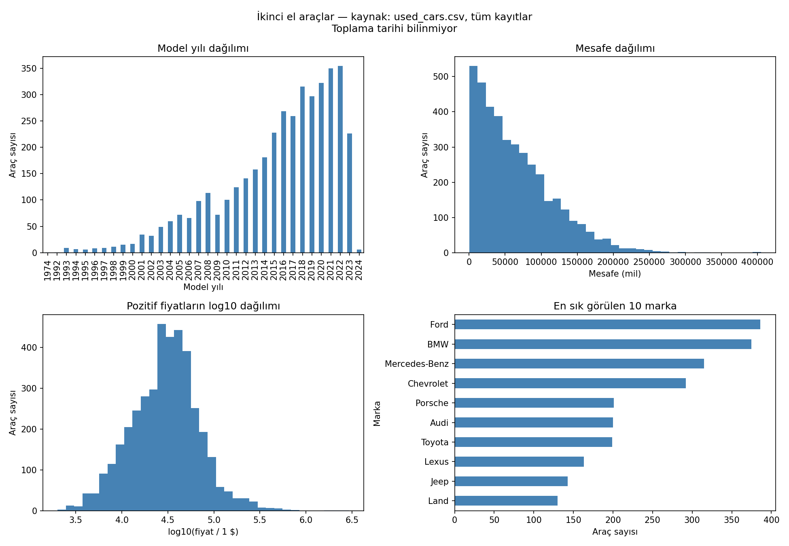

# İkinci El Araçlar — EDA Raporu

## Amaç ve kapsam
Verinin yapısını, eksiklerini, dağılımlarını ve olası sorunlarını modelleme öncesinde tanımak.
Kaynak: `used_cars.csv`. Tüm kayıtlar incelendi; örnekleme yapılmadı.
Veri toplama tarihi ve örnekleme yöntemi bilinmiyor; sonuçlar bu dosyayla sınırlıdır.
CSV değiştirilmedi; kayıt silinmedi, eksik değer doldurulmadı, özellik üretilmedi ve model eğitilmedi.

## Kullanılan yöntemler ve nedenleri
- pandas `shape`, `dtypes`, `head`, `nunique`: boyutu, türleri, örnekleri ve kategori çeşitliliğini görmek.
- `isna` ve `duplicated`: pandas tarafından tanınan eksikleri ve tüm sütunları aynı olan tekrarları bulmak.
- `value_counts(dropna=False)`: kategorileri ve eksikleri birlikte saymak.
- Düzenli ifade ile biçim kontrolü ve ayrı sayısal seriler: fiyat ve mil bilgisi metin olduğu için yalnızca EDA hesapları yapmak. Orijinal sütunlara atama yapılmadı.
- `describe`: ortalama, standart sapma, medyan, çeyrekler ve uç değerleri görmek.
- Histogramlar ve sıklık grafiği: dağılımları ve baskın markaları görmek.
- 1,5 × IQR kuralı: incelenecek uç gözlemleri işaretlemek; bunlar otomatik olarak hata sayılmaz veya silinmez.
- Spearman korelasyonu: sıralamalara dayalı ikili ilişkiyi incelemek. Nedensellik göstermez.

## Genel yapı
Satır: 4,009; sütun: 12; tamamen tekrarlı satır: 0.

```text
             veri_turu  eksik  eksik_yuzde  benzersiz_dolu
brand           object      0         0.00              57
model           object      0         0.00            1898
model_year       int64      0         0.00              34
milage          object      0         0.00            2818
fuel_type       object    170         4.24               7
engine          object      0         0.00            1146
transmission    object      0         0.00              62
ext_col         object      0         0.00             319
int_col         object      0         0.00             156
accident        object    113         2.82               2
clean_title     object    596        14.87               1
price           object      0         0.00            1569
```

## İlk beş kayıt
```text
   brand                           model  model_year     milage     fuel_type                                               engine      transmission                ext_col int_col                               accident clean_title   price
    Ford Utility Police Interceptor Base        2013 51,000 mi. E85 Flex Fuel 300.0HP 3.7L V6 Cylinder Engine Flex Fuel Capability       6-Speed A/T                  Black   Black At least 1 accident or damage reported         Yes $10,300
 Hyundai                    Palisade SEL        2021 34,742 mi.      Gasoline                                 3.8L V6 24V GDI DOHC 8-Speed Automatic        Moonlight Cloud    Gray At least 1 accident or damage reported         Yes $38,005
   Lexus                   RX 350 RX 350        2022 22,372 mi.      Gasoline                                       3.5 Liter DOHC         Automatic                   Blue   Black                          None reported         NaN $54,598
INFINITI                Q50 Hybrid Sport        2015 88,900 mi.        Hybrid  354.0HP 3.5L V6 Cylinder Engine Gas/Electric Hybrid       7-Speed A/T                  Black   Black                          None reported         Yes $15,500
    Audi       Q3 45 S line Premium Plus        2021  9,835 mi.      Gasoline                           2.0L I4 16V GDI DOHC Turbo 8-Speed Automatic Glacier White Metallic   Black                          None reported         NaN $34,999
```

## Metinlerde ek kalite kontrolleri
Eksik olarak sayılmayan boşluk ve yer tutucular ayrıca listelenir; henüz dönüştürülmez.
- `fuel_type` yer tutucu adayları: {'–': 45, 'not supported': 2}
- `engine` yer tutucu adayları: {'–': 45}
- `transmission` yer tutucu adayları: {'–': 4}
- `ext_col` yer tutucu adayları: {'–': 15}
- `int_col` yer tutucu adayları: {'–': 133}

## Sayısal özetler (geçici analiz serileri)
Dolu olup beklenen biçime uymayan fiyat: 0; mil bilgisi: 0.
Mesafe birimi mildir; kilometreye çevrilmedi. Fiyat işareti `$`; dosyada ülke/para birimi kodu doğrulanmadığından TL olarak yorumlanmadı.
```text
       model_year  milage_mi_analysis  price_dollar_analysis
count     4009.00              4009.0                 4009.0
mean      2015.52            64717.55               44553.19
std          6.10             52296.6               78710.64
min       1974.00               100.0                 2000.0
25%       2012.00             23044.0                17200.0
50%       2017.00             52775.0                31000.0
75%       2020.00             94100.0                49990.0
max       2024.00            405000.0              2954083.0
```

## IQR ile uç gözlem adayları
- `price_dollar_analysis`: alt sınır -31985.00, üst sınır 99175.00; 244 aday (%6.09). Hiçbiri silinmedi.
- `milage_mi_analysis`: alt sınır -83540.00, üst sınır 200684.00; 69 aday (%1.72). Hiçbiri silinmedi.

## Kategorik dağılımlar
Her sütun için en sık 10 dolu/eksik değer:
### brand
```text
brand
Ford             386
BMW              375
Mercedes-Benz    315
Chevrolet        292
Porsche          201
Audi             200
Toyota           199
Lexus            163
Jeep             143
Land             130
```
### model
```text
model
M3 Base               30
F-150 XLT             24
Corvette Base         22
1500 Laramie          18
Model Y Long Range    17
Camaro 2SS            17
Wrangler Sport        17
Mustang GT Premium    16
911 Carrera           16
M4 Base               15
```
### milage
```text
milage
110,000 mi.    16
45,000 mi.     15
55,000 mi.     13
120,000 mi.    13
40,000 mi.     12
54,000 mi.     12
60,000 mi.     12
65,000 mi.     12
92,000 mi.     12
73,000 mi.     11
```
### fuel_type
```text
fuel_type
Gasoline          3309
Hybrid             194
NaN                170
E85 Flex Fuel      139
Diesel             116
–                   45
Plug-In Hybrid      34
not supported        2
```
### engine
```text
engine
2.0L I4 16V GDI DOHC Turbo                               52
355.0HP 5.3L 8 Cylinder Engine Gasoline Fuel             48
420.0HP 6.2L 8 Cylinder Engine Gasoline Fuel             47
–                                                        45
300.0HP 3.0L Straight 6 Cylinder Engine Gasoline Fuel    44
240.0HP 2.0L 4 Cylinder Engine Gasoline Fuel             42
285.0HP 3.6L V6 Cylinder Engine Gasoline Fuel            40
5.7L V8 16V MPFI OHV                                     29
3.6L V6 24V MPFI DOHC                                    28
340.0HP 3.0L V6 Cylinder Engine Gasoline Fuel            28
```
### transmission
```text
transmission
A/T                               1037
8-Speed A/T                        406
Transmission w/Dual Shift Mode     398
6-Speed A/T                        362
6-Speed M/T                        248
Automatic                          237
7-Speed A/T                        209
8-Speed Automatic                  176
10-Speed A/T                       119
5-Speed A/T                         86
```
### ext_col
```text
ext_col
Black     905
White     816
Gray      496
Silver    374
Blue      349
Red       261
Green      74
Brown      43
Gold       42
Beige      38
```
### int_col
```text
int_col
Black        2025
Beige         538
Gray          472
Brown         157
–             133
White         127
Red           126
Jet Black      59
Ebony          44
Blue           29
```
### accident
```text
accident
None reported                             2910
At least 1 accident or damage reported     986
NaN                                        113
```
### clean_title
```text
clean_title
Yes    3413
NaN     596
```
### price
```text
price
$15,000    39
$12,000    29
$30,000    28
$16,000    25
$29,000    25
$17,500    24
$18,000    24
$17,000    24
$22,000    24
$8,500     23
```

## Spearman korelasyonu
Her ikili hesapta dolu gözlemler kullanılır; kategori sütunları bu hesaba dahil değildir.
```text
                       model_year  milage_mi_analysis  price_dollar_analysis
model_year                  1.000              -0.724                  0.697
milage_mi_analysis         -0.724               1.000                 -0.755
price_dollar_analysis       0.697              -0.755                  1.000
```

## Bulguların yorumu ve sonraki aşama önerileri
- `fuel_type`, `accident`, `clean_title` eksiklerinin anlamı araştırılmalı; eksik kaza kaydı kazasız, eksik tapu kaydı olumsuz olarak kabul edilmemeli.
- `clean_title` dolu kayıtlarında yalnızca `Yes` bulunuyor. Bu sütunun bilgi içeriği ve eksiklik mekanizması değerlendirilmeden ikili kodlama yapılmamalı.
- Fiyat ve mil bilgisi model öncesinde sayısal sütunlara dönüştürülmeli; biçim ve birim doğrulanmalı.
- Model, motor, şanzıman ve renk sütunlarında çok sayıda kategori var; birleştirme ve kodlama kararları sonraki aşamada verilmeli.
- Yüksek fiyat veya mesafe tek başına hatalı kayıt anlamına gelmez; IQR adayları araç özellikleriyle birlikte incelenmeli.
- Model yılı, veri toplama tarihi bilinmeden bugünkü yıla göre araç yaşına çevrilmemeli.
- Regresyonda fiyat hedef olacaktır. Kümelemede fiyatın dahil edilip edilmeyeceği amaca göre ayrıca kararlaştırılmalı.
- İleride öğrenilen doldurma, kodlama ve ölçekleme işlemleri regresyonda yalnızca eğitim bölümünde öğrenilmeli; veri sızıntısı önlenmeli.

## Grafikler

Fiyat grafiğinde yalnızca görünüm için log10 ekseni kullanıldı; veri setine dönüşüm uygulanmadı.

## Kaynak bütünlüğü
Analiz öncesi ve sonrası SHA-256 aynı:
`faad2565d2da11cd0d3d2b38e9deb08f44c34c0c6b4e27004f8140d1de22e242`
